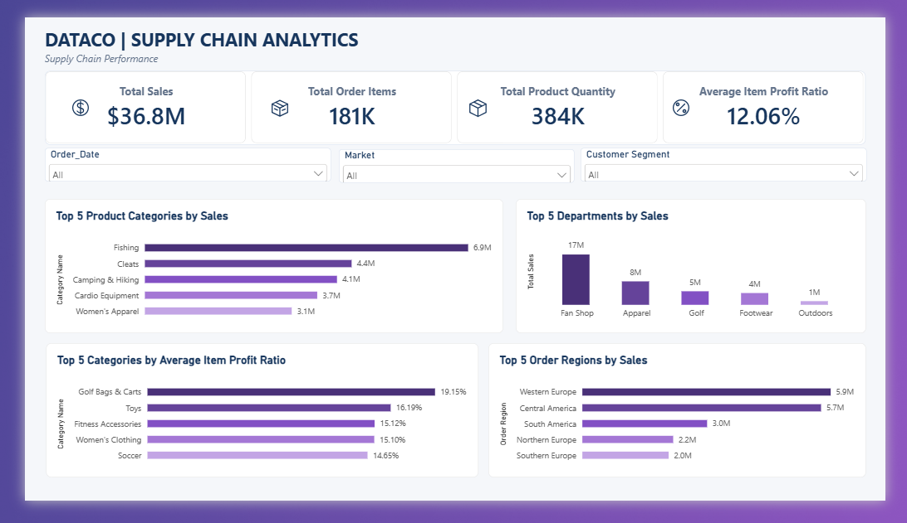

# DATACO Supply Chain Analytics

**Supply Chain Analytics | KNIME | Power BI | Machine Learning | Time-Series Forecasting**

## About the Project

How well is a supply chain performing? Where are delivery delays happening, which shipping methods perform better, and what can historical order data tell us about future demand?

This project explores these questions using the DataCo supply chain dataset. I used KNIME to prepare and analyse the data, investigate business performance, develop a late-delivery prediction workflow and forecast monthly order volumes. The findings are presented in a five-page Power BI report.

The focus was not simply on producing charts, but on turning operational data into meaningful insights that help explain supply chain performance, identify potential issues and support better-informed business decisions.

## Table of Contents

- [Key Findings](#key-findings)
- [Project Overview](#project-overview)
- [What I Worked On](#what-i-worked-on)
- [Tools and Technologies](#tools-and-technologies)
- [How the Project Was Built](#how-the-project-was-built)
- [Power BI Report](#power-bi-report)
- [Forecast Model Evaluation](#forecast-model-evaluation)
- [Key Analytical Considerations](#key-analytical-considerations)
- [Repository Structure](#repository-structure)
- [Getting Started](#getting-started)
- [What This Project Demonstrates](#what-this-project-demonstrates)
- [Data Privacy](#data-privacy)
- [About the Author](#about-the-author)

## Key Findings

### Forecast evaluation

The forecasting work produced a useful comparison rather than a claim that one model is universally reliable. On the seven-month holdout period, ARIMA (1,1,1) performed better than ARIMA (1,2,1):

- **ARIMA (1,1,1):** MAE 228.62 | RMSE 286.40 | MAPE 11.00%
- **ARIMA (1,2,1):** MAE 243.93 | RMSE 303.02 | MAPE 11.75%

I also calculated a simple **previous-month baseline** from the actual monthly volumes in the evaluation file. For the six months where a preceding month was available (August 2017–January 2018), carrying the previous month's actual volume forward gives a MAPE of **4.43%**. This baseline is materially better than either ARIMA result on those six observations. It is not a like-for-like seven-month comparison, so it should be treated as a diagnostic rather than a definitive model ranking. It does show why a simple benchmark matters before presenting a forecast model as useful.

**What this means:** the ARIMA (1,1,1) model is the stronger of the two ARIMA configurations tested, but the current evidence does not show that it beats a simple naïve forecast. The forecasting workflow needs further tuning and validation before it should guide operational decisions.

### Delivery and logistics

The prepared dataset contains **180,519 order-item records across 65,752 distinct orders**. At order-item level, the recorded delivery outcomes are:

| Delivery status | Order items | Share |
|---|---:|---:|
| Late delivery | 98,977 | 54.83% |
| Advance shipping | 41,592 | 23.04% |
| Shipping on time | 32,196 | 17.83% |
| Shipping cancelled | 7,754 | 4.30% |

More than half of the records are labelled late. That is the clearest service-performance issue in this dataset. These percentages describe recorded order-item outcomes, not unique orders.

Shipping-mode results are not what a reader might expect from the service labels:

| Shipping mode | Late-delivery rate |
|---|---:|
| First Class | **95.32%** |
| Second Class | **76.63%** |
| Same Day | **45.74%** |
| Standard Class | **38.07%** |

First Class has the highest late-delivery rate and Standard Class the lowest. This is an association in the historical data, not proof that the shipping mode caused the delay. The rates include the dataset's cancelled records in the mode totals; keep that denominator in mind when interpreting comparisons.

### Regional and commercial picture

Central Africa has the highest regional late-delivery rate at **57.96%**, while Canada has the lowest at **48.80%**. The difference is about 9.16 percentage points, although even the lowest-rate region has a substantial late share.

By recorded sales, **Western Europe** leads at approximately **5.89 million**, followed by **Central America** at **5.67 million**. **Central Asia** has the lowest regional sales total at approximately **109,840**. The supplied project documentation does not establish a reporting currency, so these are presented as dataset sales units rather than assigned a currency.

Consumer customers account for approximately **19.10 million** in sales, ahead of Corporate (**11.17 million**) and Home Office (**6.52 million**). Europe is the largest market by sales at approximately **10.87 million**, narrowly ahead of LATAM (**10.28 million**). Fan Shop is the largest department by recorded sales at approximately **17.11 million**.

### Late-delivery model

The KNIME workflow uses a **Random Forest classifier with 100 trees**. It partitions 180,519 records into 144,415 training rows (80%) and 36,104 test rows (20%). The exported test predictions produce these metrics when compared with the actual target labels:

| Metric | Test-set result |
|---|---:|
| Accuracy | 58.18% |
| Precision | 57.54% |
| Recall | 91.41% |
| F1 score | 70.63% |

The model catches a high share of actual late-risk cases, but its precision is much lower: many records predicted as late are not labelled late in the test export. Treat it as an exploratory risk-screening model, not a deployment-ready decision system.

The selected predictors include scheduled shipping days, shipping mode, quantity, sales, product price, discounts, market, region, transaction type, category, department, customer segment, year and day of week. The target is `Late_delivery_risk`. The workflow's column filter excludes actual shipping days and `Delivery Status`, reducing two obvious forms of post-outcome leakage. However, the partition is stratified by **Category Name**, not by the target column. Revisit the split strategy and re-evaluate with target-stratified splitting, a clear baseline and threshold analysis before operational use.
## Project Overview

The project combines descriptive analytics, predictive modelling and time-series forecasting to examine different aspects of supply chain performance.

The main objectives were to:

- Prepare and standardise supply chain data for analysis.
- Evaluate delivery performance and identify shipping-related patterns.
- Compare sales performance across products, customers, departments, regions and markets.
- Develop a machine-learning workflow to assess late-delivery risk.
- Forecast monthly unique order volume using ARIMA models.
- Present analytical findings through an interactive Power BI report.

## What I Worked On

The descriptive analysis (WF02) addresses ten business questions across delivery performance, logistics, sales and order trends.

1. **Overall Delivery Performance**  
   What percentage of order items are delivered late, on time, shipped in advance, or cancelled?

2. **Shipping Mode Performance**  
   Which shipping modes have the highest number of late deliveries, and how do their late-delivery rates compare?

3. **Product Category Profitability**  
   Which product categories generate the highest sales revenue and recorded profit, and which categories perform poorly?

4. **Customer Segment Performance**  
   Which customer segments generate the highest sales revenue?

5. **Regional Sales Performance**  
   Which order regions generate the highest and lowest sales revenue?

6. **Late Delivery Rate by Shipping Mode**  
   Which shipping mode has the highest late-delivery rate after accounting for the number of order items handled by each mode?

7. **Department Performance**  
   Which departments contribute the most to total sales revenue?

8. **Market Performance**  
   Which markets generate the highest and lowest sales revenue?

9. **Actual vs. Scheduled Shipping Time**  
   How do actual shipping times compare with scheduled shipping times, and how often do deliveries take longer than expected?

10. **Monthly Sales Trend**  
    How does sales revenue change from month to month, and are there noticeable increases, decreases, or seasonal patterns?

The corresponding prepared dataset and analysis outputs are available in the repository. The numerical findings should be read alongside the definitions and denominators used in each analysis.

**[Explore the processed dataset and analysis outputs](https://github.com/rotimi2020/dataco-supply-chain-analytics/tree/main/data/processed)**

## Tools and Technologies

| Tool | How I used it |
|---|---|
| KNIME Analytics Platform | Data preparation, descriptive analysis, machine learning and forecasting workflows |
| Microsoft Power BI | Interactive reporting, KPI monitoring and data visualisation |
| Microsoft Excel | Data inspection and supporting analysis |
| CSV | Storage and exchange of datasets and analytical results |

## How the Project Was Built

I organised the analytical work into four KNIME workflows, each addressing a different stage of the project.

### 1. Data Preparation

**Workflow:** `WF01_Data_Preparation`

Prepared the supply chain dataset for analysis by standardising column names, adjusting data types, converting date fields, filtering unnecessary columns and exporting the cleaned dataset.

### 2. Descriptive Analytics

**Workflow:** `WF02_Descriptive_Analytics`

Investigated the ten business questions covering delivery performance, shipping modes, product categories, customer segments, regional sales, departments, markets, shipping times and monthly sales trends.

### 3. Late Delivery Prediction

**Workflow:** `WF03_Late_Delivery_Prediction`

Built a Random Forest classifier with 100 trees to estimate `Late_delivery_risk`. The workflow uses an 80/20 partition and exports predictions for 36,104 test records. On that export, accuracy is 58.18%, precision 57.54%, recall 91.41% and F1 70.63%. Actual shipping days and delivery status are excluded from the selected predictor columns. The workflow remains exploratory: its partition is stratified by Category Name rather than the target, and the results need a target-stratified re-run and threshold/baseline comparison before operational use.

### 4. Order Volume Forecasting

**Workflow:** `WF04_Order_Volume_Forecasting`

Tested two ARIMA configurations to forecast monthly unique order volume for February 2018 to January 2019. The available evaluation file covers a seven-month holdout period; a simple previous-month baseline was also checked separately as a diagnostic.

**[Explore all four KNIME workflows](https://github.com/rotimi2020/dataco-supply-chain-analytics/tree/main/knime)**

## Power BI Report

I developed a five-page Power BI report to bring the analytical findings together in an interactive, business-focused format.

| Report page | What it covers |
|---|---|
| Executive Overview | Overall supply chain and business performance |
| Logistics Performance | Shipping methods and delivery performance |
| Supply Chain Performance | Sales across products, departments, regions and markets |
| Late Delivery Prediction | Delivery risk analysis and model evaluation |
| Order Volume Forecast | Historical order volumes and forecast comparison |

### 📷 Power BI Report Previews

The screenshots below provide a preview of the five report pages, highlighting the key visualisations and insights developed through the analysis.

| Executive Overview | Logistics Performance |
|---|---|
|  |  |

| Supply Chain Performance | Late Delivery Prediction | Order Volume Forecast |
|---|---|---|
|  |  |  |

**[Explore the Power BI project files](https://github.com/rotimi2020/dataco-supply-chain-analytics/tree/main/powerbi)**

## Forecast Model Evaluation

I evaluated two ARIMA configurations using a seven-month holdout period.

| Model | MAE | RMSE | MAPE |
|---|---:|---:|---:|
| ARIMA (1,1,1) | 228.62 | 286.40 | 11.00% |
| ARIMA (1,2,1) | 243.93 | 303.02 | 11.75% |

ARIMA (1,1,1) recorded lower MAE, RMSE and MAPE values, making it the better-performing of the two models on the evaluation data.

The evaluation was based on a seven-month holdout period, so the results should be interpreted within that limitation. Performance over a longer evaluation period would provide further evidence of the model's forecasting reliability.

## Key Analytical Considerations

The results point to a few practical questions worth taking back to an operations team:

- **Review First Class exceptions first.** Its 95.32% late rate warrants a closer look at routes, order mix, promised delivery windows and service assignment. The result alone is not a reason to move volume into another mode.
- **Separate service failures from cancellations.** Recalculate mode-level delivery rates excluding cancelled records as a sensitivity check, then compare both versions.
- **Investigate regional variation.** Start with Central Africa and South Asia, but compare shipment volumes, product mix, shipping mode and scheduled delivery windows before attributing the difference to geography.
- **Use the classifier as a review queue, not an automatic decision.** Its high recall may help flag orders for attention, but its modest precision means teams would also review many orders that are not late.
- **Keep forecasting honest.** ARIMA (1,1,1) is the better of the two ARIMA configurations tested, but the separate previous-month diagnostic performed better on its six comparable transitions. More validation is needed before relying on the 12-month forecast.

These are recommendations for investigation based on the observed results, not claims of savings or improvements already achieved.

## Repository Structure

The repository is organised to make the project materials easy to explore.

```text
dataco-supply-chain-analytics/
│
├── data/
│   └── processed/
│       ├── Prepared supply chain dataset
│       ├── Q01–Q10 analysis outputs
│       ├── Late delivery predictions
│       └── Order volume forecasts and model evaluation
│
├── documentation/
│   └── Project documentation and business questions
│
├── knime/
│   ├── WF01_Data_Preparation.knwf
│   ├── WF02_Descriptive_Analytics.knwf
│   ├── WF03_Late_Delivery_Prediction.knwf
│   └── WF04_Order_Volume_Forecasting.knwf
│
├── powerbi/
│   ├── Power BI report files
│   └── screenshots/
│       ├── 01_Executive_Overview.PNG
│       ├── 02_Logistics_Performance.PNG
│       ├── 03_Supply_Chain_Performance.PNG
│       ├── 04_Late_Delivery_Prediction.PNG
│       └── 05_Order_Volume_Forecast.PNG
│
└── README.md
```

The project folders provide access to the relevant materials:

- [Processed data and analysis outputs](https://github.com/rotimi2020/dataco-supply-chain-analytics/tree/main/data/processed)
- [Four KNIME workflows](https://github.com/rotimi2020/dataco-supply-chain-analytics/tree/main/knime)
- [Power BI report files and screenshots](https://github.com/rotimi2020/dataco-supply-chain-analytics/tree/main/powerbi)

## Getting Started

You can explore the project using the following tools:

1. **KNIME Analytics Platform:** Open the KNIME workflow files in the `knime` folder to inspect the data preparation, descriptive analysis, prediction and forecasting processes.
2. **Microsoft Power BI Desktop:** Open the available `.pbix` report in the `powerbi` folder to explore the interactive dashboards.
3. **Microsoft Excel:** Open the available analysis files to inspect the supporting business-question outputs.
4. **CSV files:** Review the prepared dataset and analytical results in the `data/processed` folder.

The project files are available directly through the repository links above. No separate application installation or deployment is required to explore the supplied reports and outputs, although the relevant desktop software is needed to open its native files.

## What This Project Demonstrates

Through this project, I applied:

- Data preparation, cleaning and transformation.
- Exploratory and descriptive data analysis.
- Supply chain and logistics performance analysis.
- Business performance reporting and KPI monitoring.
- Machine-learning workflow development.
- Late-delivery risk analysis.
- Time-series forecasting and model evaluation.
- Interactive dashboard development using Power BI.
- Translation of analytical findings into business-focused reporting.

## Data Privacy

The source dataset contains customer-related fields. Do not redistribute raw records containing personally identifiable information. The public project should contain only appropriately reviewed data and outputs. The supplied project files do not establish a dataset licence; check the original publisher's terms before reusing or redistributing the source data.

## About the Author

**Rotimi S. Omosewo**

Data and Reporting Analyst | Operations and Supply Chain Analytics

I am interested in using data analysis, business intelligence and reporting to understand operational performance and support evidence-based decisions.

[GitHub Profile](https://github.com/rotimi2020)

---

**Project:** DATACO Supply Chain Analytics  
**Tools:** KNIME Analytics Platform | Microsoft Power BI | Excel  
**Focus:** Supply Chain | Logistics | Business Intelligence | Predictive Analytics | Forecasting
