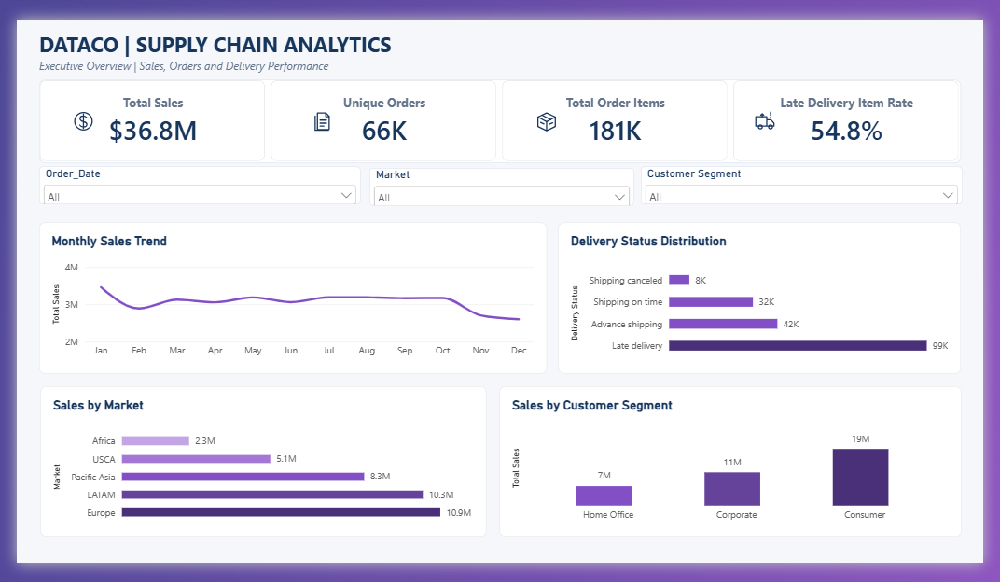
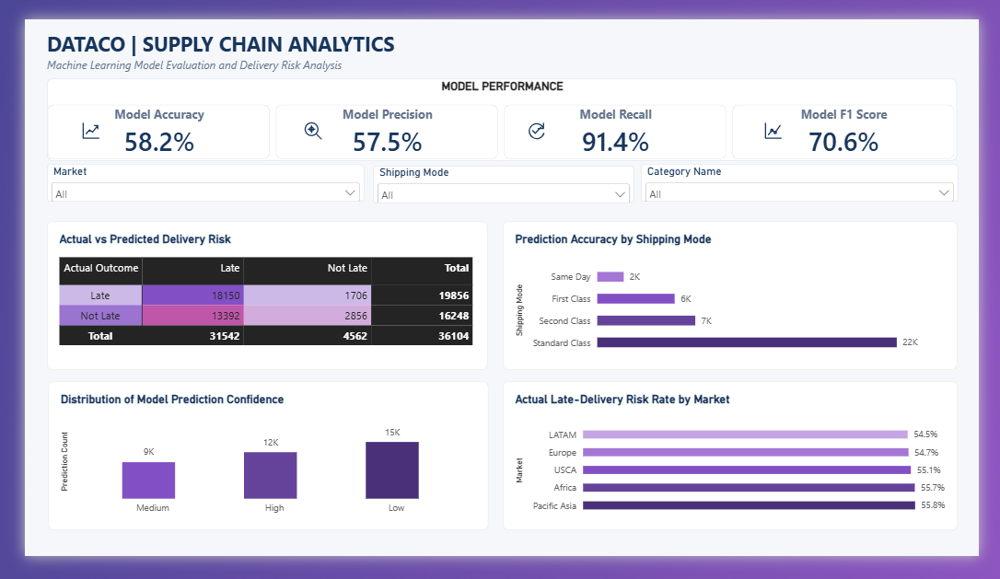
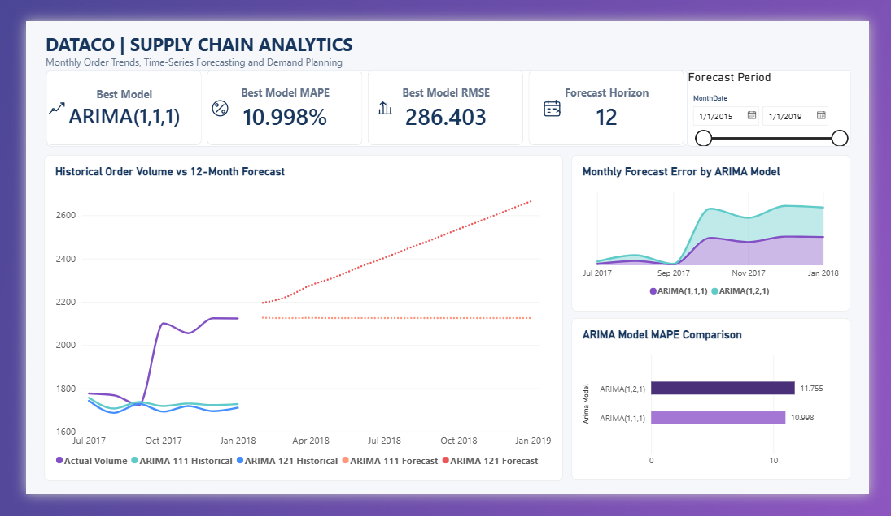

# DATACO Supply Chain Analytics

Where do deliveries go wrong, and can the data predict it? I explored that question with KNIME and Power BI, through delivery analysis, a late-delivery classifier and a monthly order forecast.

**Tools:** KNIME · Power BI · Excel

## What I found

- **More than half of order items arrive late.** 98,977 of 180,519 items (54.83%), across 65,752 orders.
- **First Class is the worst shipping mode, with 95.32% late.** Standard Class is the best at 38.07%. That is the reverse of what the service names suggest.
- **Central Africa (57.96%) and South Asia (56.27%) have the highest late rates.** Canada is lowest at 48.80%.
- **The late-delivery model did not outperform a simple baseline.** My Random Forest identified 91.41% of late items, but it also wrongly flagged about 82% of the records that were not actually late. An always-late baseline scored a 70.96% F1 on the same test set, compared with 70.63% for my model.
- **The forecast did not beat a simple baseline.** ARIMA (1,1,1) had an 11.00% MAPE on the seven-month holdout. Copying the previous month's volume had a 4.43% MAPE across six monthly transitions. The periods are not identical, so this comparison is indicative, not conclusive.

I compared both models with simple baselines. The classifier did not outperform its baseline, and the forecast comparison was not like-for-like. I therefore treat both as experiments, not deployment-ready solutions.

[Dashboard pages](https://github.com/rotimi2020/dataco-supply-chain-analytics/tree/main/powerbi) · [KNIME workflows](https://github.com/rotimi2020/dataco-supply-chain-analytics/tree/main/knime) · [Processed data](https://github.com/rotimi2020/dataco-supply-chain-analytics/tree/main/data/processed) · [Documentation](https://github.com/rotimi2020/dataco-supply-chain-analytics/tree/main/documentation)

## What I did

I split the work into four KNIME workflows.

1. **WF01 Data Preparation.** Renamed columns, fixed data types, converted dates, dropped columns I did not need and exported a clean file.
2. **WF02 Descriptive Analytics.** Answered ten business questions on delivery, shipping modes, categories, customer segments, regions, departments, markets, shipping times and monthly sales.
3. **WF03 Late Delivery Prediction.** Random Forest with 100 trees, trained on 144,415 rows and tested on 36,104. The target is `Late_delivery_risk`. I left out actual shipping days and `Delivery Status` because they give away the answer.
4. **WF04 Order Volume Forecasting.** Two ARIMA setups on monthly unique orders, tested on a seven-month holdout, with a forecast for February 2018 to January 2019.

The Power BI report has five pages: Executive Overview, Logistics Performance, Supply Chain Performance, Late Delivery Prediction and Order Volume Forecast.

| Logistics Performance | Supply Chain Performance |
|---|---|
|  |  |

| Late Delivery Prediction | Order Volume Forecast |
|---|---|
|  |  |

## The numbers

**Delivery status (order items)**

| Status | Items | Share |
|---|---:|---:|
| Late delivery | 98,977 | 54.83% |
| Advance shipping | 41,592 | 23.04% |
| Shipping on time | 32,196 | 17.83% |
| Shipping cancelled | 7,754 | 4.30% |

**Late rate by shipping mode**

| Mode | Late rate |
|---|---:|
| First Class | 95.32% |
| Second Class | 76.63% |
| Same Day | 45.74% |
| Standard Class | 38.07% |

**Random Forest, test set**

| Metric | Result |
|---|---:|
| Accuracy | 58.18% |
| Precision | 57.54% |
| Recall | 91.41% |
| F1 | 70.63% |

**Forecast, seven-month holdout**

| Model | MAE | RMSE | MAPE |
|---|---:|---:|---:|
| ARIMA (1,1,1) | 228.62 | 286.40 | 11.00% |
| ARIMA (1,2,1) | 243.93 | 303.02 | 11.75% |

**Sales** (the dataset does not state a currency, so these are plain units). Western Europe leads the regions at about 5.89 million and Central Asia is lowest at about 109,840. Consumer customers bring in about 19.10 million, ahead of Corporate (11.17 million) and Home Office (6.52 million). Europe is the biggest market at about 10.87 million, and Fan Shop is the biggest department at about 17.11 million.

**Read these with care**
- Late rates by shipping mode show a link in the data. They do not prove the mode caused the delays. Cancelled items are included in the mode totals.
- I split the model data by Category Name, not by the target. Treat the model numbers as rough.
- The baseline comparison covers six months, not seven, because the first month has no previous month to copy.

## What I would do next

- Re-split the data on the target and add a threshold and AUC check for the classifier.
- Try a seasonal forecast and test it against the previous-month baseline over a longer window.
- Recalculate late rates without cancelled items.
- Look into First Class: routes, scheduled days and order mix. I would not move volume to another mode before that.

## Run it yourself

1. Download the data from [Kaggle](https://www.kaggle.com/datasets/shashwatwork/dataco-smart-supply-chain-for-big-data-analysis) or the [original Mendeley record](https://data.mendeley.com/datasets/8gx2fvg2k6/5).
2. Open `WF01_Data_Preparation` first and update the input file path for your machine.

To view the dashboards you need Power BI Desktop. The CSV outputs open in Excel.

## Data source

I downloaded the data from the [Kaggle copy uploaded by Shashwat Tiwari](https://www.kaggle.com/datasets/shashwatwork/dataco-smart-supply-chain-for-big-data-analysis). The original dataset is on Mendeley Data under CC BY 4.0.

Constante, F., Silva, F. and Pereira, A. (2019). *DataCo SMART SUPPLY CHAIN FOR BIG DATA ANALYSIS* (Version 5). Mendeley Data. https://doi.org/10.17632/8gx2fvg2k6.5

That licence covers the dataset only, not my workflows or dashboard design. The raw download has customer-related fields, so it is not in this repository. The repo holds the prepared data and my outputs.

## About me

**Rotimi S. Omosewo**, Data and Reporting Analyst focused on operations and supply chain analytics.

[LinkedIn](https://www.linkedin.com/in/rotimi-sheriff-omosewo) · [Portfolio](https://rotimi2020.github.io) · [GitHub](https://github.com/rotimi2020)
